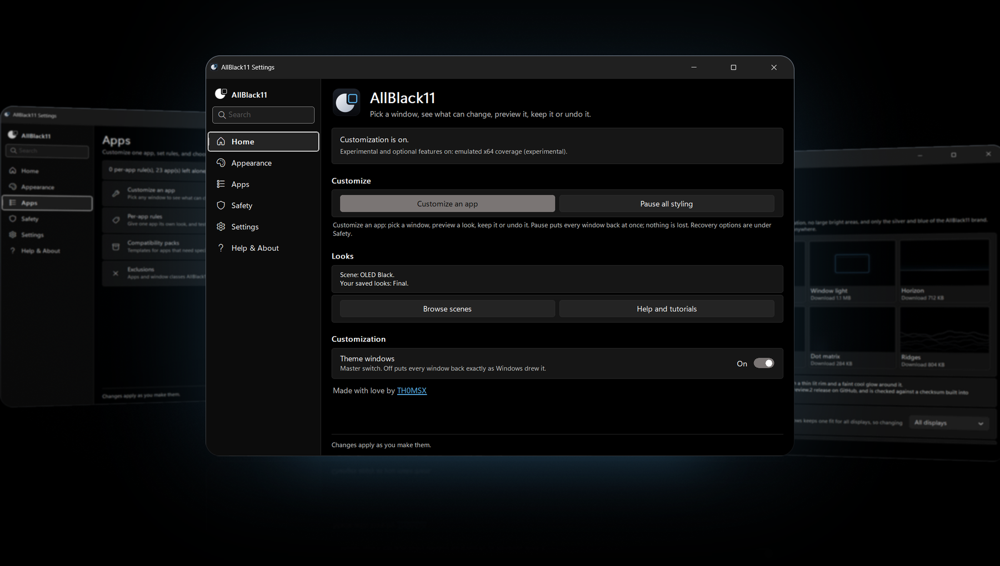
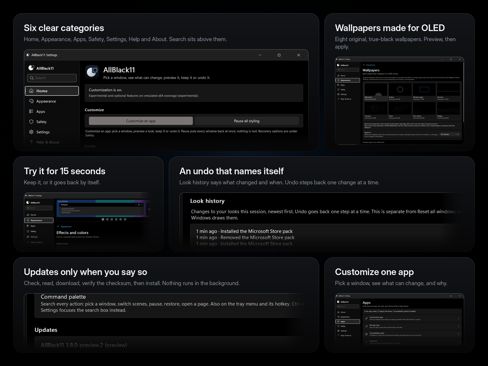
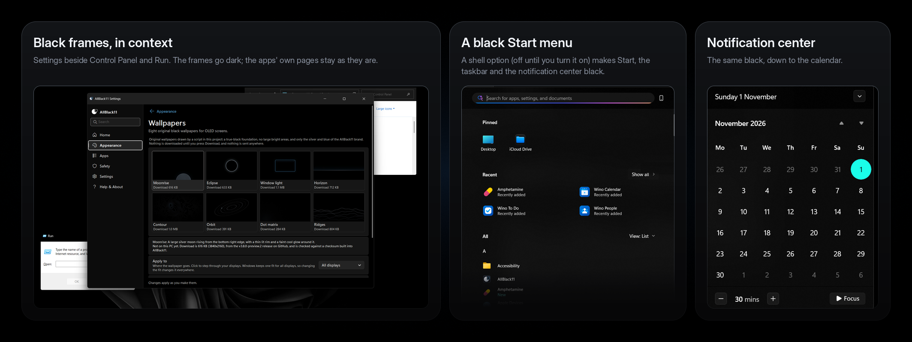

<p align="center"></p>

<div align="center">

**Make Windows 11 truly black.** OLED-friendly, featherweight, fully reversible.

<a href="https://github.com/TH0MSX/AllBlack11/releases/tag/v3.8.0-preview.2"></a>


<a href="LICENSE"></a>

[**Download**](#download) · [**See it**](#see-it) · [**Features**](#what-you-get) · [**How far it is checked**](#how-far-it-has-been-checked) · [**Safety**](#safety-and-uninstall) · [**FAQ**](#faq)

</div>

<p align="center"></p>

## A small tray app for a very black Windows

Windows 11 dark mode still paints gray title bars, a gray taskbar and a tinted Start menu. AllBlack11 asks Windows for black ones, lets you try any look for 15 seconds before you keep it, and puts everything back whenever you say so.

| True black | Featherweight | Reversible |
| --- | --- | --- |
| Black title bars, borders, taskbar, Start menu and notification center, plus eight original OLED wallpapers. | Native ARM64 and x64. About 12 MB of RAM on a Snapdragon ZenBook (measured on 3.0 Preview), near-idle CPU, no polling. | Every change is snapshotted and undone from the same place, by Undo, or by uninstalling. |

> [!IMPORTANT]
> **Use 3.8 Preview.** It replaces every older version and keeps your settings. It is a **pre-release**, and this is how far it has been checked: the ARM64 build runs on its author's Windows 11 ARM64 PC (the screenshots on this page are from it); the x64 build is built and unit-tested on a real Windows x64 runner but has **not been run on an x64 PC**; screen readers, the updater against real releases and wallpaper apply have not been tried on hardware. Details: [what is verified](docs/dev/EVIDENCE.md). The binaries are unsigned, so SmartScreen may warn.

### Kept up to date, in the open

AllBlack11 received **over 15 updates in November 2026 alone** ([every one is a commit you can read](https://github.com/TH0MSX/AllBlack11/commits/main/?since=2026-11-01&until=2026-11-30)). The aim is **at least one update every month**, each with bug fixes, compatibility tweaks for Windows updates and new features. That is a target, not a promise: every release says plainly what has and has not been checked, and the in-app updater only ever tells you; it never installs by itself.

## Download

**Recommended: [3.8 Preview](https://github.com/TH0MSX/AllBlack11/releases/tag/v3.8.0-preview.2).** Pick the files for your PC:

| Your PC | Installer (recommended) | Portable zip |
| --- | --- | --- |
| **Snapdragon** and other ARM64 | [`AllBlack11-Setup-arm64.exe`](https://github.com/TH0MSX/AllBlack11/releases/download/v3.8.0-preview.2/AllBlack11-Setup-arm64.exe) | [`AllBlack11-arm64.zip`](https://github.com/TH0MSX/AllBlack11/releases/download/v3.8.0-preview.2/AllBlack11-arm64.zip) |
| **Intel and AMD** | [`AllBlack11-Setup-x64.exe`](https://github.com/TH0MSX/AllBlack11/releases/download/v3.8.0-preview.2/AllBlack11-Setup-x64.exe) | [`AllBlack11-x64.zip`](https://github.com/TH0MSX/AllBlack11/releases/download/v3.8.0-preview.2/AllBlack11-x64.zip) |

Setup installs for your account only (no administrator prompt) and updates an older version in place. On an ARM64 PC pick the ARM64 files; About tells you when a build is running under emulation. The older [3.7 Preview](https://github.com/TH0MSX/AllBlack11/releases/tag/v3.7.0-preview.1) is still available.

1. **Run Setup.** If SmartScreen objects: **More info**, then **Run anyway**.
2. **Open Settings** from the tray icon, pick a **Quick look** under Appearance, and watch the preview.
3. Press **Keep**, or wait 15 seconds and it goes back by itself.

## See it

<p align="center"></p>

<sub>Screenshots are AllBlack11 3.8 Preview on a Snapdragon (ARM64) Windows 11 PC. The arrangement, rounding and lighting are mockup styling; the windows themselves are not altered. Source: [`docs/mockup-source`](docs/mockup-source).</sub>

### Windows, in context

<p align="center"></p>

<sub>The desktop, the Start menu and the notification center on the author's PC, cropped to the windows only (the taskbar, notifications and anything personal are left out). The black Start menu and notification center are an optional shell setting that is off until you turn it on; Control Panel's and Run's own pages stay light, because only their frames are styled.</sub>

## What you get

- **A Settings app that works like Windows Settings.** Six categories (Home, Appearance, Apps, Safety, Settings, Help & About), landscape layout, a Back link on every subpage, and a **search box** that finds settings, scenes, packs, wallpapers and help (Ctrl+K). A result opens the right page and marks the control; it never changes anything by itself.
- **Per-window looks:** dark caption, border, text color, corners, and a backdrop (Mica, Mica Alt, Acrylic or tinted acrylic). Presets: Pure OLED, Accent glass, Classic Mica, Factory defaults.
- **Scenes and a Look Book:** OLED Black, Graphite, Midnight Accent, Focus, Living Room, and looks you save. A palette from a picture, recipes you can import and export, a remixer that refuses unreadable text.
- **Customize one app:** pick any window, see what can change and why, preview it for 20 seconds, save it as a rule or leave it alone. Rules explain which one won and why.
- **Eight original OLED wallpapers**, generated by a script in this repository, downloaded one at a time only when you press Download, checked against a built-in checksum.
- **An updater that only tells you.** Check, read the notes, download, verify the SHA-256, then install. Stable or include previews. No telemetry.
- **Safe to experiment:** every look runs as a 15-second trial; Look history with Undo; Pause; Reset all windows; a last-known-good config; safe start after repeated crashes.
- **The shell:** OLED taskbar, black Start and notification center, and a Restart Explorer button for when Windows needs a nudge.
- **Quiet:** event-driven, no timer while the PC is idle.
- **Optional and off by default:** dark classic dialogs (a same-architecture hook for windows like Run), emulated x64 coverage on ARM64, identity accents, Day / Night scenes.

AllBlack11 works in three honest layers; knowing which one a window is in explains most "why didn't it change?" questions:

| Layer | What it does | Reaches into other apps? |
| --- | --- | --- |
| **A. Frame styling** | Title bar, text and border colors, corners and backdrops, set through Windows' own window-frame attributes. | No |
| **B. Legacy layer** (opt-in) | Recolors the controls of *classic dialogs* (Run, old installers, property pages) from inside the app. | Yes, per dialog, only same-CPU, non-elevated, never games or shell |
| **C. App integrations** | None ship yet. The Microsoft Store and Calculator packs are experiments (see [limitations](#limitations)). | No |

### New in 3.8 Preview

A new Settings shell with global search; an updater; compatibility packs (experimental); the wallpaper gallery; an exclusion manager; a recipe remixer; named text boxes for screen readers; and one typed registry for every page, which fixed the command palette opening the wrong page. The full list is in the [changelog](CHANGELOG.md); what moved where is in [`INVENTORY-3.8-stabilization.md`](docs/dev/INVENTORY-3.8-stabilization.md).

## How far it has been checked

| Area | Status |
| --- | --- |
| ARM64 build on a Windows 11 ARM64 PC | **Run by the author.** The Settings shell, hub pages, Effects, Safety with Look history, Settings with Updates, and the Wallpapers page were seen working (the screenshots above). |
| x64 build | Built and unit-tested on a Windows x64 CI runner. **Not run on an x64 PC.** |
| Unit tests | 367, on Linux and on both native Windows CI runners. |
| Updater against real releases, wallpaper download and apply, Store and Calculator behavior | **Not yet checked on hardware.** Store and Calculator showed no visible change on the author's PC, so those two packs are labeled experimental. |
| Screen readers (Narrator, NVDA) | **Unverified.** Names and roles are in place and self-tested, not heard. |

`docs/dev/EVIDENCE.md` says, feature by feature, what was run and what was only built; `docs/dev/SMOKE-TEST.md` is the checklist.

## Support

AllBlack11 is free, MIT-licensed and has no locked features, no ads and no telemetry. If it saves you time and you want to say thanks, a tip is welcome through [PayPal](https://paypal.me/peplinski00). It is never required, and bug reports, screenshots and test results from your own PC help just as much.

## Install

**Setup.exe.** Run the installer for your CPU. It installs for your account only, so there is no administrator prompt. It adds a Start menu shortcut and an entry in Settings > Apps, and it can start AllBlack11 at sign-in. Running a newer Setup updates in place and keeps your config. To uninstall, use Settings > Apps, or run Setup again and choose **Uninstall**. Uninstall puts the Windows settings AllBlack11 changed back first, then asks whether to keep your config.

<details>
<summary>Silent install, and the zip with <code>install.ps1</code></summary>

Silent install for scripts: `AllBlack11-Setup-arm64.exe /S` (add `/NOAUTOSTART`, `/NOSHORTCUT`, `/NOLAUNCH` as needed). Silent uninstall: `AllBlack11-Setup-arm64.exe --uninstall /S` (add `/PURGE` to delete the config too).

**Zip.** Unzip, right-click `install.ps1`, choose **Run with PowerShell**. `-NoAutostart` skips the HKCU Run value:

```powershell
powershell -ExecutionPolicy Bypass -File .\install.ps1
```

Both paths copy `AllBlack11.exe` and `AllBlack11Hook.dll` to `%LOCALAPPDATA%\Programs\AllBlack11`, create `%APPDATA%\AllBlack11\config.json` when you do not have one, and add `AllBlack11` under `HKCU\Software\Microsoft\Windows\CurrentVersion\Run`. The hook DLL stays on disk until you opt in.

If `%APPDATA%\PepaTheme\config.json` is still there and the new config is not, the first launch (or Setup) copies that config and `snapshots.json`, stops the old PepaTheme, removes its Run value, and deletes `%LOCALAPPDATA%\Programs\PepaTheme`.

</details>

The binaries are unsigned. SmartScreen may say it protected your PC. Choose **More info**, then **Run anyway**.

## Settings and the tray menu

Right-click the tray icon for the menu (a single left-click opens it too; double-click opens Settings).

```
AllBlack11 3.8 Preview · ARM64
──────────
Enabled                  Master switch for dark title bars, borders and backdrops.
Settings…                Every option, with a live preview and an explanation.
Command palette…         Search every action and run it. Settings has its own search box (Ctrl+K there).
Presets  ›               Pure OLED · Accent glass · Classic Mica · Factory defaults
Scenes  ›                OLED Black · Graphite · Midnight Accent · Focus · Living Room, and your saved looks
Pause all styling        Emergency stop: puts every window back and stops the legacy layer.
──────────
Shell  ›                 OLED taskbar · Black Start, taskbar & notification center
                         Restart Explorer…
Maintenance  ›           Reload config · Open config · Open data folder
                         Write diagnostics report · Reset all windows
──────────
Start with Windows
──────────
Exit
```

**Settings** is a native, custom-drawn window with a navigation pane on the left and a search box above it:

| Category | What is in it |
| --- | --- |
| **Home** | Is customization on, the current look, **Customize an app**, Pause, saved looks, update badge. |
| **Appearance** | Scenes and looks, Effects and colors (with a live preview), Wallpapers, Schedule and accents, Palette and recipes. |
| **Apps** | Customize an app (the window picker), Per-app rules, Compatibility packs, Exclusions. |
| **Safety** | Try, keep or revert; Undo and Look history; Pause and reset; last known good; Experimental features. |
| **Settings** | AllBlack11's own theme, start with Windows, shortcuts, Updates. |
| **Help & About** | Help and tutorials, Diagnostics and support, About (version, CPU type, verification status, credits and licenses). |

Settings follows the Windows 11 Settings pattern, with full keyboard access and a UI Automation provider; `docs/dev/UI-GUIDELINES.md` says which Microsoft guidance it follows and where it deviates.

| Menu item | What it does |
| --- | --- |
| **Enabled** | Window-frame pass. Off restores frames and is saved in the config. |
| **Presets** | One-click looks. They rewrite the default look; rules and exclusions are kept. |
| **OLED taskbar** | `UseOLEDTaskbarTransparency` = 1. |
| **Black Start, taskbar & notification center** | Black shell palette, transparency on, light theme off. |
| **Restart Explorer…** | Ends `explorer.exe` and lets Windows start it again. Open File Explorer windows close, so it asks first. |
| **Reload / Open config / Open data folder** | Reads `config.json` again, or opens it or its folder. |
| **Write diagnostics report** | Writes `check.txt` (version, CPU type, Windows build, settings) and opens it. |
| **Reset all windows** | Puts frames back until you reload or turn Enabled on again. |
| **Exit** | Restores frames and quits. Shell toggles stay until you uncheck them or uninstall. |

Command line: `AllBlack11.exe --check` prints the diagnostics report, `--restart-explorer` restarts the shell, `--open-settings=apps/packs` opens Settings on a page, and `--restore` quits the app and undoes the shell tweaks and CaptionHeight without needing the tray (add `--quiet` for scripts).

## Configuration

Defaults live in `default`. A rule overrides only the fields it names. Full key list: **[docs/CONFIG.md](docs/CONFIG.md)**.

Control Panel (`mmc.exe`) with a darker tinted acrylic, keeping the black caption and accent border:

```json
{
  "process": "mmc.exe",
  "backdrop": "tintedAcrylic",
  "acrylicOpacity": 0.7
}
```

| Key | Default | Role |
| --- | --- | --- |
| `backdrop` | `mica` | `mica`, `micaAlt`, `acrylic`, `tintedAcrylic`, `none`, `auto` |
| `acrylicTint` | `#000000` | Tint for `tintedAcrylic`, as `#RRGGBB` |
| `acrylicOpacity` | `0.55` | `0.0`–`1.0`. `0.55` is alpha `0x8C` |
| `tintedAcrylicOnMoveFallback` | `true` | Blur while dragging, acrylic when the move ends |
| `shell.oledTaskbar` | `false` | OLED taskbar toggle |
| `shell.blackShell` | `false` | Black Start, taskbar, and notification center |

`borderColor: "accent"` follows `AccentColorMenu`. `0xFF748501` is RGB `#018574`.

## How it works

<details>
<summary>DWM frames, tinted acrylic, and window events</summary>

For each accepted top-level window, AllBlack11 calls `DwmSetWindowAttribute` from its own process. Those calls are messages to `dwm.exe`. The other process never loads this program.

| Attribute | ID | Default |
| --- | --- | --- |
| `DWMWA_USE_IMMERSIVE_DARK_MODE` | 20 | on |
| `DWMWA_WINDOW_CORNER_PREFERENCE` | 33 | system default |
| `DWMWA_BORDER_COLOR` | 34 | accent, or `none` |
| `DWMWA_CAPTION_COLOR` | 35 | `#000000` |
| `DWMWA_TEXT_COLOR` | 36 | `#FFFFFF` |
| `DWMWA_SYSTEMBACKDROP_TYPE` | 38 | Mica (`2`) |

`tintedAcrylic` uses `SetWindowCompositionAttribute` with `WCA_ACCENT_POLICY` (19) and `ACCENT_ENABLE_ACRYLICBLURBEHIND` (4). The gradient is `AABBGGRR` from `acrylicTint` and `acrylicOpacity`. DWM's own backdrop is set to none so the two effects do not stack. This is the same kind of cross-process call TranslucentTB makes. It is not injection. If the call returns false, that process gets plain DWM acrylic, logged once.

New windows come from `SetWinEventHook` with `WINEVENT_OUTOFCONTEXT`, plus one scan at startup. The hook callback runs inside AllBlack11. There is no timer while the machine is idle.

On the author's Snapdragon ZenBook the process sat at about 12 MB of RAM.

</details>

## Safety and uninstall

Everything is per-user. No administrator rights. The default path does not inject: window events are out-of-context, and frames are DWM messages.

**Experimental: dark legacy windows** is the exception, and it ships off. Turning it on loads `AllBlack11Hook.dll` with `SetWindowsHookEx` into specific threads. The DLL matches the exe (ARM64 or x64). It will not enter an elevated process, a process that cannot be opened, or anything on the exclude list (games and launchers included). Exit, or turn the switch off, and the hooks come out. Antivirus and anti-cheat software sometimes flag this kind of DLL. Leave it off if you play games that watch for hooks.

Frame changes are remembered in `%APPDATA%\AllBlack11\snapshots.json` and put back on Exit, Disable, or Reset. Shell changes are remembered in `shell-backup.json` and put back when you uncheck the item or run the uninstaller.

If a toggle is turned on when Windows is **already** in the target state, that backup slot is marked `alreadyApplied` instead of pretending the current values are the original. Uncheck then deletes `AccentPalette` (Windows rebuilds it after `ImmersiveColorSet`), sets Personalize `ColorPrevalence` to `0`, and removes `UseOLEDTaskbarTransparency`. A backup file that already holds real originals is not replaced. Details are in [docs/CONFIG.md](docs/CONFIG.md).

```powershell
powershell -ExecutionPolicy Bypass -File .\uninstall.ps1
```

That exits the app, restores `shell-backup.json` and `CaptionHeight` from `metrics-backup.json` when those files exist, removes the Run key, and deletes the install folder and `%APPDATA%\AllBlack11`. Caption height returns to the saved value after you sign out.

By hand: Exit from the tray, uncheck the Shell items, delete the exe, delete `%APPDATA%\AllBlack11`, and delete the `AllBlack11` Run value.

## Limitations

<details>
<summary>What AllBlack11 cannot recolor</summary>

DWM and the accent policy paint the frame. The app still paints its own client area. Store app pages, and most classic Win32 content, keep the app's own background unless **Experimental: dark legacy windows** is on.

With that switch on, standard dialog controls (`#32770`, static text, buttons, edits, list boxes) are recolored in-process, and list views are asked to use `DarkMode_Explorer`. The Run dialog and classic dialog pages are the ones this covers. Explorer-hosted Control Panel is deliberately left alone: its address bar and toolbar break when themed dark over a light page. MMC consoles such as Device Manager are covered, but DirectUI, XAML, and HTML regions can stay light. `SetWindowTheme` from AllBlack11's own process is also tried first; many programs ignore that. Nothing here changes system-wide colors with `SetSysColors`.

Custom title bars ignore caption and border colors. That includes Chrome and a lot of Electron apps. Borderless DirectComposition windows and full-screen games are skipped. A windowed game with a normal caption can still be themed; add its exe under `exclude`. GeForce NOW and the usual launchers are excluded in the default config.

**Microsoft Store and Calculator.** Their frames can only be asked for colors, and nothing visible has been shown to change, so the two built-in packs for them are labeled experimental and are not recommended. The pages inside those apps are drawn by the apps and cannot be recolored from outside; use an app's own theme option, or Windows' app mode, for that.

Elevated windows that refuse a limited process query are left alone. High contrast pauses frame theming.

</details>

## FAQ

<details>
<summary>Common questions</summary>

**Does it need an administrator account?**
No. The manifest asks for `asInvoker`. Registry writes are HKCU.

**SmartScreen blocked it.**
The exe is unsigned. More info, then Run anyway.

**Chrome is unchanged.**
Chrome draws its own title bar. AllBlack11 only changes frames Windows itself paints.

**The Start menu went black, then Windows put the color back.**
Changing the accent in Settings rebuilds `AccentPalette`. While **Black Start, taskbar & notification center** is on, AllBlack11 watches that key and puts slots 4–6 back to black. It does not write again when they are already black.

**I unchecked a Shell item and nothing changed.**
If those registry values were already at the target when you first enabled the toggle, there was no older snapshot. Uncheck now falls back to the Windows defaults described above. If `shell-backup.json` already had originals from before that, those are what get restored.

**The Store or Calculator did not change.**
Expected. Those windows are hosted by Windows' app frame and draw their own pages. The experimental packs under Apps > Compatibility packs ask only for frame colors that are close to the default look, and **Check now** shows where the request stops. For the page colors, use the app's own theme option or Windows' app mode (Settings > Personalization > Colors).

**How do updates work?**
Settings > Updates asks GitHub (only when you press Check, or once a day if you turn that on) whether a newer release exists. It never installs by itself: you read what is new, download, the checksum is verified, then you choose Install.

**Where did PepaTheme go?**
Same program, new name. The first launch copies the old config and snapshots when the new ones are missing.

</details>

## Roadmap

- The two-week stabilization freeze after 3.8: only critical regression and security fixes.
- Run the x64 build on an x64 PC, and finish the hardware checklist (`docs/dev/SMOKE-TEST.md`), including a Narrator pass.
- A signed build, if a certificate is available.
- Investigate, on real hardware, whether Windows applies frame colors to the Store and Calculator windows; until then the packs stay experimental.
- Later: palette locking, display-aware scenes and a window anatomy view (see `docs/dev/INVENTORY-3.8.md`).

## Credits

Built by Tomasz Pepliński ([@TH0MSX](https://github.com/TH0MSX)) with AI coding assistance from Cursor's agent (credited as `cursoragent` in the commit history) and Claude (credited in commit trailers). Every feature was directed, tested and used daily by Tomasz on a Snapdragon ASUS ZenBook A14 (Windows 11 ARM64).

Window frames use the public DWM attribute APIs. Tinted acrylic uses `SetWindowCompositionAttribute`, the same user32 entry TranslucentTB uses on the taskbar, called from this process only. Icons are Segoe Fluent Icons, used from the font Windows provides; the AllBlack11 mark and the wallpapers are original.


## License

[MIT](LICENSE). Copyright (c) 2026 Tomasz Pepliński.

<p align="center">Made with love by <a href="https://github.com/TH0MSX">TH0MSX</a></p>
