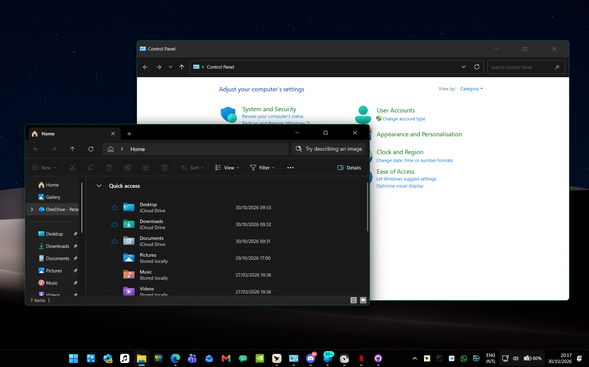
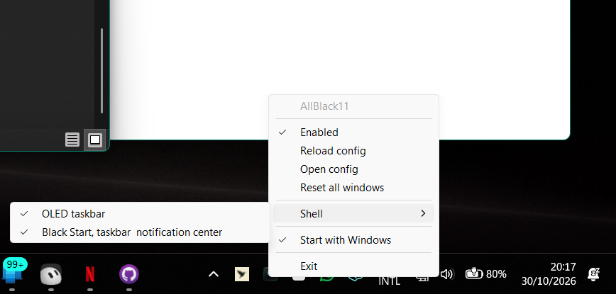

<p align="center"></p>

# AllBlack11

<p align="center">
  <a href="https://github.com/TH0MSX/AllBlack11/releases/latest"></a>
  <a href="https://github.com/TH0MSX/AllBlack11/releases/latest"></a>
  <a href="LICENSE"></a>
  
  
  
</p>

<p align="center"><strong>Make Windows 11 truly black.</strong> OLED-friendly, featherweight, fully reversible.</p>

## 🌙 Why

Windows 11 dark mode still paints gray title bars, a gray taskbar, and a tinted Start menu. AllBlack11 is a small tray program that makes Windows 11 OLED-friendly: an all-black taskbar, a dark Start menu and notification center, and darker window frames. It stays under 50 MB of RAM, stays out of other processes, and ships native ARM64 and x64 builds. On a Snapdragon ZenBook it sat at about 12 MB, with near-idle CPU while it waits on window events.

## ✨ Features

<table>
  <tr>
    <td width="50%" align="center">
      
      <br><strong>Black Start and an OLED taskbar</strong>
      <br>Start, the taskbar, and Phone Link share one black surface.
    </td>
    <td width="50%" align="center">
      
      <br><strong>Notification center</strong>
      <br>The notification shade and calendar follow the same black palette.
    </td>
  </tr>
  <tr>
    <td width="50%" align="center">
      
      <br><strong>Frames and tinted acrylic</strong>
      <br>File Explorer and Control Panel: black captions, teal borders, darker acrylic.
    </td>
    <td width="50%" align="center">
      
      <br><strong>One tray menu</strong>
      <br>Frames, shell colors, autostart, and a full undo.
    </td>
  </tr>
</table>

- Per-window dark captions, border, text color, corners, and backdrop (Mica, Mica Alt, Acrylic, or tinted acrylic).
- Rules by exe name, plus a built-in skip list for the shell, games, and launchers.
- Out-of-context window events. No polling loop while the PC is idle.
- Original frame attributes go back on Exit, Disable, or Reset.
- Shell tweaks are HKCU only, snapshotted, and undone from the same menu or the uninstaller.

## 📦 Download

Grab the latest zip from **[github.com/TH0MSX/AllBlack11/releases/latest](https://github.com/TH0MSX/AllBlack11/releases/latest)**.

| PC | Zip |
| --- | --- |
| Snapdragon and other ARM64 | `AllBlack11-arm64.zip` |
| Intel and AMD | `AllBlack11-x64.zip` |

The ARM64 build is native. The x64 zip runs on ARM64 only under emulation. `install.ps1` checks the CPU with `IsWow64Process2`, including when PowerShell itself is the x64 emulator.

## 🛠️ Install

1. Unzip the download.
2. Right-click `install.ps1` and choose **Run with PowerShell**.

No administrator account. `-NoAutostart` skips the HKCU Run value if you launch the script yourself:

```powershell
powershell -ExecutionPolicy Bypass -File .\install.ps1
```

The script copies `AllBlack11.exe` to `%LOCALAPPDATA%\Programs\AllBlack11`, creates `%APPDATA%\AllBlack11\config.json` when you do not have one, and adds `AllBlack11` under `HKCU\Software\Microsoft\Windows\CurrentVersion\Run`.

The exe is unsigned. SmartScreen may say it protected your PC. Choose **More info**, then **Run anyway**.

If `%APPDATA%\PepaTheme\config.json` is still there and the new config is not, the first launch copies that config and `snapshots.json`. The installer also asks the old `PepaTheme.exe --exit`, removes its Run value, and deletes `%LOCALAPPDATA%\Programs\PepaTheme`.

## 🖱️ Tray menu

```
AllBlack11
──────────
Enabled
Reload config
Open config
Reset all windows
──────────
Shell
    OLED taskbar
    Black Start, taskbar & notification center
──────────
Start with Windows
──────────
Exit
```

A check mark means that item is on.

| Item | What it does |
| --- | --- |
| **Enabled** | Window-frame pass. Off restores frames and is saved in the config. |
| **Reload config** | Reads `config.json` again. |
| **Open config** | Opens the JSON in your editor. |
| **Reset all windows** | Puts frames back until you reload or turn Enabled on again. |
| **OLED taskbar** | `UseOLEDTaskbarTransparency` = 1. |
| **Black Start, taskbar & notification center** | Black shell palette, transparency on, light theme off. |
| **Start with Windows** | The HKCU Run value. |
| **Exit** | Restores frames and quits. Shell toggles stay until you uncheck them or uninstall. |

## ⚙️ Configuration

Defaults live in `default`. A rule overrides only the fields it names. Full key list: **[docs/CONFIG.md](docs/CONFIG.md)**.

Control Panel (`mmc.exe`) with a darker tinted acrylic, keeping the black caption and accent border:

```json
{
  "process": "mmc.exe",
  "backdrop": "tintedAcrylic",
  "acrylicOpacity": 0.7
}
```

| Key | Default | Role |
| --- | --- | --- |
| `backdrop` | `mica` | `mica`, `micaAlt`, `acrylic`, `tintedAcrylic`, `none`, `auto` |
| `acrylicTint` | `#000000` | Tint for `tintedAcrylic`, as `#RRGGBB` |
| `acrylicOpacity` | `0.55` | `0.0`–`1.0`. `0.55` is alpha `0x8C` |
| `tintedAcrylicOnMoveFallback` | `true` | Blur while dragging, acrylic when the move ends |
| `shell.oledTaskbar` | `false` | OLED taskbar toggle |
| `shell.blackShell` | `false` | Black Start, taskbar, and notification center |

`borderColor: "accent"` follows `AccentColorMenu`. `0xFF748501` is RGB `#018574`.

## 🔍 How it works

<details>
<summary>DWM frames, tinted acrylic, and window events</summary>

For each accepted top-level window, AllBlack11 calls `DwmSetWindowAttribute` from its own process. Those calls are messages to `dwm.exe`. The other process never loads this program.

| Attribute | ID | Default |
| --- | --- | --- |
| `DWMWA_USE_IMMERSIVE_DARK_MODE` | 20 | on |
| `DWMWA_WINDOW_CORNER_PREFERENCE` | 33 | system default |
| `DWMWA_BORDER_COLOR` | 34 | accent, or `none` |
| `DWMWA_CAPTION_COLOR` | 35 | `#000000` |
| `DWMWA_TEXT_COLOR` | 36 | `#FFFFFF` |
| `DWMWA_SYSTEMBACKDROP_TYPE` | 38 | Mica (`2`) |

`tintedAcrylic` uses `SetWindowCompositionAttribute` with `WCA_ACCENT_POLICY` (19) and `ACCENT_ENABLE_ACRYLICBLURBEHIND` (4). The gradient is `AABBGGRR` from `acrylicTint` and `acrylicOpacity`. DWM's own backdrop is set to none so the two effects do not stack. This is the same kind of cross-process call TranslucentTB makes. It is not injection. If the call returns false, that process gets plain DWM acrylic, logged once.

New windows come from `SetWinEventHook` with `WINEVENT_OUTOFCONTEXT`, plus one scan at startup. The hook callback runs inside AllBlack11. There is no timer while the machine is idle.

On the author's Snapdragon ZenBook the process sat at about 12 MB of RAM.

</details>

## 🛡️ Safety and uninstall

Everything is per-user. No administrator rights, no DLL injection, no remote threads, no `SetWindowsHookEx`.

Frame changes are remembered in `%APPDATA%\AllBlack11\snapshots.json` and put back on Exit, Disable, or Reset. Shell changes are remembered in `shell-backup.json` and put back when you uncheck the item or run the uninstaller.

If a toggle is turned on when Windows is **already** in the target state, that backup slot is marked `alreadyApplied` instead of pretending the current values are the original. Uncheck then deletes `AccentPalette` (Windows rebuilds it after `ImmersiveColorSet`), sets Personalize `ColorPrevalence` to `0`, and removes `UseOLEDTaskbarTransparency`. A backup file that already holds real originals is not replaced. Details are in [docs/CONFIG.md](docs/CONFIG.md).

```powershell
powershell -ExecutionPolicy Bypass -File .\uninstall.ps1
```

That exits the app, restores `shell-backup.json`, removes the Run key, and deletes the install folder and `%APPDATA%\AllBlack11`.

By hand: Exit from the tray, uncheck the Shell items, delete the exe, delete `%APPDATA%\AllBlack11`, and delete the `AllBlack11` Run value.

## ⚠️ Limitations

<details>
<summary>What AllBlack11 cannot recolor</summary>

DWM and the accent policy paint the frame. The app still paints its own client area. Store app pages, and most classic Win32 content, keep the app's own background.

Custom title bars ignore caption and border colors. That includes Chrome and a lot of Electron apps. Borderless DirectComposition windows and full-screen games are skipped. A windowed game with a normal caption can still be themed; add its exe under `exclude`. GeForce NOW and the usual launchers are excluded in the default config.

Elevated windows that refuse a limited process query are left alone. High contrast pauses frame theming.

</details>

## ❓ FAQ

<details>
<summary>Common questions</summary>

**Does it need an administrator account?**
No. The manifest asks for `asInvoker`. Registry writes are HKCU.

**SmartScreen blocked it.**
The exe is unsigned. More info, then Run anyway.

**Chrome is unchanged.**
Chrome draws its own title bar. AllBlack11 only changes frames Windows itself paints.

**The Start menu went black, then Windows put the color back.**
Changing the accent in Settings rebuilds `AccentPalette`. While **Black Start, taskbar & notification center** is on, AllBlack11 watches that key and puts slots 4–6 back to black. It does not write again when they are already black.

**I unchecked a Shell item and nothing changed.**
If those registry values were already at the target when you first enabled the toggle, there was no older snapshot. Uncheck now falls back to the Windows defaults described above. If `shell-backup.json` already had originals from before that, those are what get restored.

**Where did PepaTheme go?**
Same program, new name. The first launch copies the old config and snapshots when the new ones are missing.

</details>

## 🗺️ Roadmap

- A signed build, if a certificate is available.
- More per-app recipes in the default config, still opt-in.

## 👤 Credits

[Tomasz Pepliński](https://github.com/TH0MSX) (TH0MSX).

Window frames use the public DWM attribute APIs. Tinted acrylic uses `SetWindowCompositionAttribute`, the same user32 entry TranslucentTB uses on the taskbar, called from this process only.

## 📄 License

[MIT](LICENSE). Copyright (c) 2026 Tomasz Pepliński.
