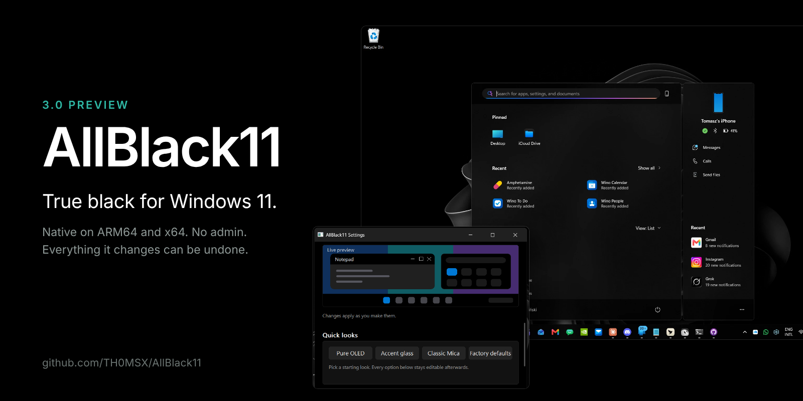
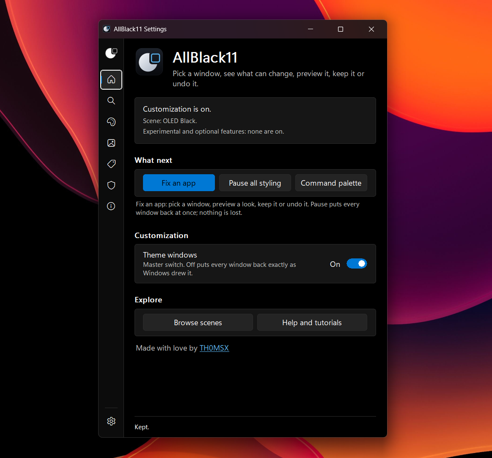
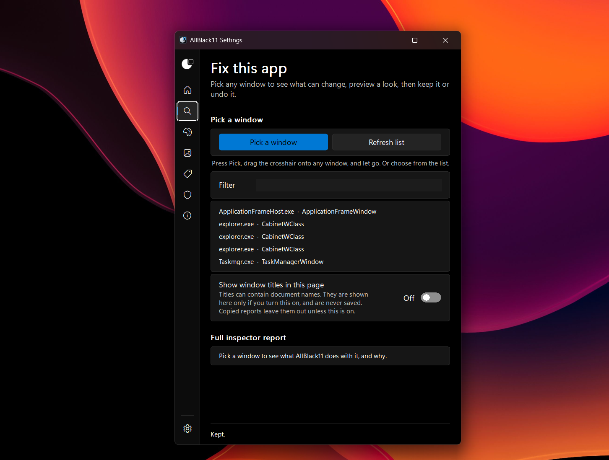
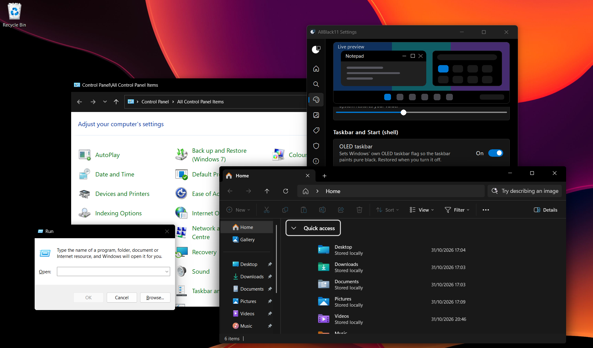
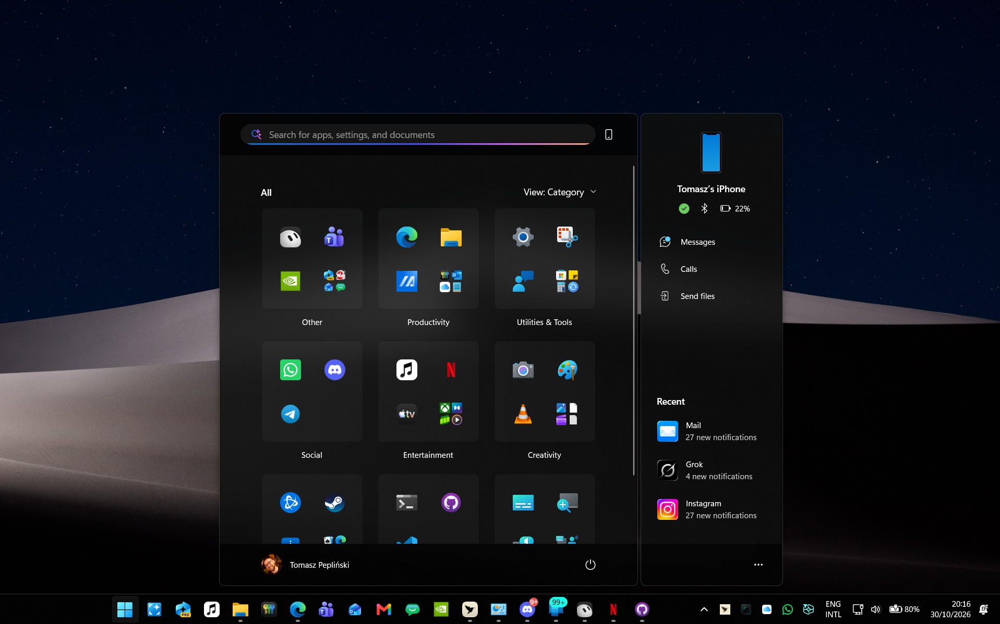
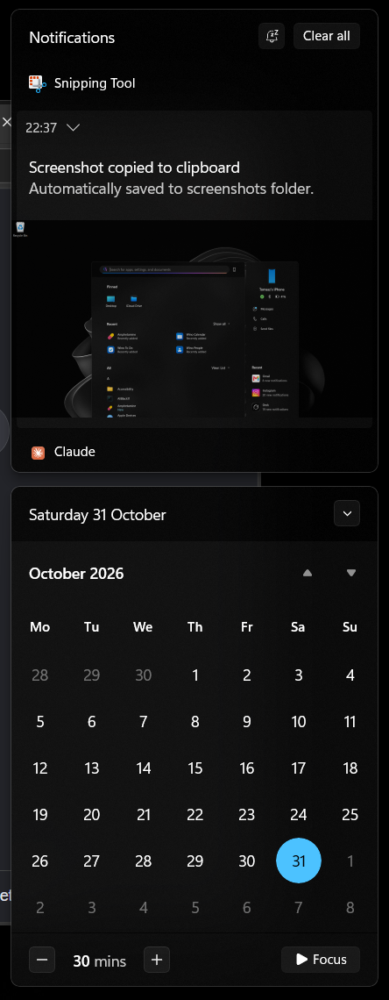
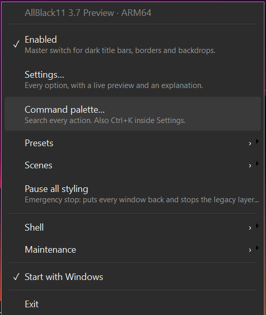

<p align="center"></p>

<div align="center">

# AllBlack11

**Make Windows 11 truly black.** OLED-friendly, featherweight, fully reversible.

<a href="https://github.com/TH0MSX/AllBlack11/releases/tag/v3.7.0-preview.1"></a>
<a href="https://github.com/TH0MSX/AllBlack11/releases/tag/v3.7.0-preview.1"></a>


<a href="LICENSE"></a>

[**⬇️ Download**](#-download) · [**🚀 Quick start**](#-quick-start) · [**✨ Features**](#-features) · [**🖱️ Settings**](#️-tray-menu-and-settings) · [**⚙️ Config**](#️-configuration) · [**🛡️ Safety**](#️-safety-and-uninstall) · [**❓ FAQ**](#-faq)

</div>

> [!IMPORTANT]
> **Use 3.7 Preview.** It is the version to install: it replaces 3.0 Preview and keeps everything in it, and adds a new icon, a redesigned Settings with first-run setup and Help, scenes and a Look Book, a window picker that explains what AllBlack11 did and why, a look history with Undo, a rule playground and safer recovery. **[Download 3.7 Preview](https://github.com/TH0MSX/AllBlack11/releases/tag/v3.7.0-preview.1)**.
>
> **How far it has been checked, plainly:** the ARM64 build has been run by its author on a Windows 11 ARM64 PC. The x64 build is built and unit-tested on a real Windows x64 runner but has **not yet been run on an x64 PC**, and the full hardware checklist is not finished. See [what is verified](docs/dev/EVIDENCE.md) and the [smoke test](docs/dev/SMOKE-TEST.md). It is labelled a pre-release because that checking is not finished. Everything it changes can be undone.
>
> Made by [@TH0MSX](https://github.com/TH0MSX) with AI assistance (Cursor, and Claude), tested on real ARM64 hardware.

## 🌙 Why

Windows 11 dark mode still paints gray title bars, a gray taskbar, and a tinted Start menu. AllBlack11 is a small tray program that fixes that.

| 🖤 True black | 🪶 Featherweight | ↩️ Reversible |
| --- | --- | --- |
| Black taskbar, Start menu, notification center, and darker window frames. | Native ARM64 and x64. About 12 MB of RAM on a Snapdragon ZenBook (measured on 3.0 Preview), near-idle CPU. | Every change is snapshotted and undone from the same menu, or by uninstalling. |

## 🚀 Quick start

1. **Download** the Setup for your PC from the [3.7 Preview release](https://github.com/TH0MSX/AllBlack11/releases/tag/v3.7.0-preview.1).
2. **Run it.** No administrator prompt. If SmartScreen objects, choose **More info**, then **Run anyway**.
3. **Open Settings** from the tray icon, pick a **Quick look**, and watch the preview.

## ✨ Features

<table>
  <tr>
    <td width="50%" align="center">
      
      <br><strong>Home</strong>
      <br>Is customization on, which look is active, what to do next, and Pause one click away.
    </td>
    <td width="50%" align="center">
      
      <br><strong>Fix this app</strong>
      <br>Pick any window, see what can change and why, preview it, then keep it or undo it.
    </td>
  </tr>
  <tr>
    <td colspan="2" align="center">
      
      <br><strong>Black frames across apps</strong>
      <br>Control Panel, Run and File Explorer, with AllBlack11 Settings. 3.7 Preview on a Snapdragon (ARM64) PC.
    </td>
  </tr>
  <tr>
    <td colspan="2" align="center">
      
      <br><strong>Black Start and an OLED taskbar</strong>
      <br>Start, the taskbar, and Phone Link share one black surface.
    </td>
  </tr>
  <tr>
    <td width="50%" align="center">
      
      <br><strong>Notification center</strong>
      <br>The shade and the calendar follow the same palette.
    </td>
    <td width="50%" align="center">
      
      <br><strong>Tray menu</strong>
      <br>Presets, scenes, the command palette and Pause, one right-click away.
    </td>
  </tr>
</table>

- 🎨 **Per-window look:** dark captions, border, text color, corners, and backdrop (Mica, Mica Alt, Acrylic, or tinted acrylic).
- 🪄 **Presets:** Pure OLED, Accent glass, Classic Mica, Factory defaults.
- 🖥️ **Shell:** OLED taskbar, black Start and notification center, and a **Restart Explorer** button for when Windows needs a nudge.
- 🧩 **Per-app rules and exclusions:** by exe name, with a built-in skip list for the shell, games, and launchers.
- 🪶 **Quiet:** event-driven, no polling loop while the PC is idle.
- 🔁 **Undo everywhere:** original frame attributes go back on Exit, Disable, or Reset. Shell tweaks are HKCU only, snapshotted, and undone from the same menu or the uninstaller.
- 🧪 **Optional and off by default:** **Dark legacy windows**. A same-architecture hook DLL recolors classic dialogs such as Run. See [Safety](#️-safety-and-uninstall).

## 🧪 What is new in 3.7 Preview (and since 3.0)

AllBlack11 works in three honest layers. Knowing which one a window is in explains most "why didn't it change?" questions.

| Layer | What it does | Reaches into other apps? |
| --- | --- | --- |
| **A. Frame styling** | Title bar, text and border colors, corners, Mica, Mica Alt, Acrylic and experimental tinted Acrylic, set through Windows' own window-frame attributes. | No |
| **B. Legacy layer** (opt-in) | Recolors the controls of *classic dialogs* (Run, old installers, property pages) from inside the app: labels, edit boxes, buttons, check boxes, combo and list boxes, list views, tree views. | Yes, per dialog, only same-CPU, non-elevated, never games or shell |
| **C. App integrations** | None ship yet. | No |

What 3.7 adds:

- **A new icon and identity.** An original moon-and-window mark (not the Windows logo), a one-color tray mark that follows the taskbar theme, and a filled moon when styling is on and an outline when it is off or paused.
- **Look history with Undo (3.7).** Safety lists your recent changes by name and **Undo last change** steps back one at a time. It is separate from Reset all windows, which puts windows back as Windows draws them.
- **Rule playground (3.7).** Type an app, or use the window you picked, and see which rule would win and why, without applying anything.
- **Contrast check (3.7).** Measures the colors a look uses against the contrast guidance, says Passes or Fails, and offers the nearest fix.
- **Safer recovery (3.7).** A config only becomes the "last known good" copy after it has actually run for a minute, and files are flushed to disk before they replace the old ones.
- **A calmer Exit (3.7).** Quitting asks only when it would revert a trial, remove the classic-dialog layer or stop the helper.

What 3.6.0-preview.2 added:

- **A redesigned Settings.** A left navigation pane (Home, Fix this app, Appearance, Scenes, Rules, Safety, Diagnostics, Settings & help), one design system with Light, Dark and high contrast, **first-run setup**, six walkthroughs, searchable Help, full keyboard access (Keep and Revert included) and a UI Automation provider for screen readers.

What the 3.5 and 3.6 previews added:

- **Legacy dark mode that holds up.** Each control family has its own technique, states stay readable, controls that cannot be darkened safely are left alone and reported, and Explorer, Control Panel and dialogs with embedded web or Explorer views are never touched. A built-in **control harness** lets you check it without relying on another app.
- **Window picker and inspector.** Drag a crosshair onto any window to see its executable, class, CPU type, which rule applied and why, where each setting came from, and what Windows answered. The report says "accepted by Windows; appearance not verified" and never claims more.
- **Effects Studio.** Per-app looks, Focus Look, Reduce effects on battery saver or remote sessions, and a demonstration window that shows how materials behave.
- **Rules that explain themselves.** Match by executable, class, path, package or (optionally) title, with clear precedence and conflict warnings.
- **Safe to experiment.** Presets and recipes run as a 15-second trial; a broken config falls back to the last known good one; shell restores skip anything you changed yourself.
- **Experimental on ARM64:** an on-demand x64 helper for emulated x64 dialogs. It has not been run on hardware yet.
- **Fix this app (3.6).** Pick a window and see, per surface (title bar, border, backdrop, app content, classic controls), what can change and why, then preview it for 20 seconds, save it as a rule, exclude the app, or restore it.
- **Scenes and a Look Book (3.6).** OLED Black, Graphite, Midnight Accent, Focus and Living Room, plus looks you save. Switching a scene never touches your per-app rules. Build a look from a picture, compare before and after on windows AllBlack11 owns, and switch from the tray or the **command palette** (Ctrl+K in Settings).
- **Safety page (3.6).** Emergency pause, reset, undo shell changes, last known good, safe start after repeated crashes, and the status of every experimental piece. Identity accents, Day / Night scenes and the palette hotkey are optional and off by default.

**Verification:** the ARM64 build has been run on a Windows 11 ARM64 PC by its author; the x64 build, Narrator, and the full hardware checklist are still to do. `docs/dev/EVIDENCE.md` says feature by feature what has and has not been checked, and `docs/dev/INVENTORY-3.7.md` lists what exists and what is deliberately not built yet.

Honest limits: Chromium, Electron, WinUI and many modern apps draw their own opaque client area and often their own title bar, so a backdrop cannot show through them and caption colors may not apply. AllBlack11 does not change whole-window opacity, and no feature here is universal. Settings is custom drawn: it has full keyboard access and a UI Automation provider for screen readers, but that provider has not yet been tried with Narrator and the native text boxes still lack an accessible label, so treat screen reader support as unverified.

## ⬇️ Download

**Recommended: [3.7 Preview](https://github.com/TH0MSX/AllBlack11/releases/tag/v3.7.0-preview.1).** Grab the files for your PC:

| Your PC | Installer (recommended) | Portable zip |
| --- | --- | --- |
| **Snapdragon** and other ARM64 | [`AllBlack11-Setup-arm64.exe`](https://github.com/TH0MSX/AllBlack11/releases/download/v3.7.0-preview.1/AllBlack11-Setup-arm64.exe) | [`AllBlack11-arm64.zip`](https://github.com/TH0MSX/AllBlack11/releases/download/v3.7.0-preview.1/AllBlack11-arm64.zip) |
| **Intel and AMD** | [`AllBlack11-Setup-x64.exe`](https://github.com/TH0MSX/AllBlack11/releases/download/v3.7.0-preview.1/AllBlack11-Setup-x64.exe) | [`AllBlack11-x64.zip`](https://github.com/TH0MSX/AllBlack11/releases/download/v3.7.0-preview.1/AllBlack11-x64.zip) |

Running Setup over an older version updates it in place and keeps your config. The older [3.0 Preview](https://github.com/TH0MSX/AllBlack11/releases/tag/v3.0.0-preview.2) is still available but no longer recommended.

> [!TIP]
> On an ARM64 PC, pick the ARM64 files. The x64 build works through emulation and Settings > About will tell you when that is happening.

## 🛠️ Install

**Setup.exe.** Run the installer for your CPU. It installs for your account only, so there is no administrator prompt. It adds a Start menu shortcut and an entry in Settings > Apps, and it can start AllBlack11 at sign-in. Running a newer Setup updates in place and keeps your config. To uninstall, use Settings > Apps, or run Setup again and choose **Uninstall**. Uninstall puts the Windows settings AllBlack11 changed back first, then asks whether to keep your config.

<details>
<summary>Silent install, and the zip with <code>install.ps1</code></summary>

Silent install for scripts: `AllBlack11-Setup-arm64.exe /S` (add `/NOAUTOSTART`, `/NOSHORTCUT`, `/NOLAUNCH` as needed). Silent uninstall: `AllBlack11-Setup-arm64.exe --uninstall /S` (add `/PURGE` to delete the config too).

**Zip.** Unzip, right-click `install.ps1`, choose **Run with PowerShell**. `-NoAutostart` skips the HKCU Run value:

```powershell
powershell -ExecutionPolicy Bypass -File .\install.ps1
```

Both paths copy `AllBlack11.exe` and `AllBlack11Hook.dll` to `%LOCALAPPDATA%\Programs\AllBlack11`, create `%APPDATA%\AllBlack11\config.json` when you do not have one, and add `AllBlack11` under `HKCU\Software\Microsoft\Windows\CurrentVersion\Run`. The hook DLL stays on disk until you opt in.

If `%APPDATA%\PepaTheme\config.json` is still there and the new config is not, the first launch (or Setup) copies that config and `snapshots.json`, stops the old PepaTheme, removes its Run value, and deletes `%LOCALAPPDATA%\Programs\PepaTheme`.

</details>

The binaries are unsigned. SmartScreen may say it protected your PC. Choose **More info**, then **Run anyway**.

## 🖱️ Tray menu and Settings

Right-click the icon for the menu. A single left-click opens it too. Double-click opens Settings.

```
AllBlack11 3.7 Preview · ARM64
──────────
Enabled                  Master switch for dark title bars, borders and backdrops.
Settings…                Every option, with a live preview and an explanation.
Command palette…         Search every action. Also Ctrl+K inside Settings.
Presets  ›               Pure OLED · Accent glass · Classic Mica · Factory defaults
Scenes  ›                OLED Black · Graphite · Midnight Accent · Focus · Living Room, and your saved looks
Pause all styling        Emergency stop: puts every window back and stops the legacy layer.
──────────
Shell  ›                 OLED taskbar · Black Start, taskbar & notification center
                         Restart Explorer…
Maintenance  ›           Reload config · Open config · Open data folder
                         Write diagnostics report · Reset all windows
──────────
Start with Windows
──────────
Exit
```

Menu items carry a one-line explanation of what they do. A check mark means that item is on. In dark mode the menu is dark, with padded rows and rounded corners. Light mode stays light. High contrast uses the normal system menu. The tray icon is a one-color moon that follows the taskbar theme: filled when styling is on, an outline when it is off or paused.

**Settings** is a native window. A left pane has eight pages: **Home** (is customization on, the current look, what to do next, Pause), **Fix this app** (pick a window, see what can change, preview, keep or undo), **Appearance** (a live preview of a mock window, Start menu and taskbar, plus every look option), **Scenes**, **Rules**, **Safety**, **Diagnostics**, and **Settings & help** (walkthroughs, searchable help, replay the first-run setup, and a System / Light / Dark choice for AllBlack11's own windows, which never changes what it applies to other apps). Every option sits on its own card: the name and a plain-language explanation on the left, the control on the right. **Restart Explorer** is under the shell options on Appearance, and the **About** card on Settings & help says whether you are running natively on ARM64.

> The screenshots above are 3.7 Preview on a Snapdragon (ARM64) PC. `docs/dev/UI-GUIDELINES.md` says which Microsoft design guidance Settings follows and where it deviates.

| Item | What it does |
| --- | --- |
| **Enabled** | Window-frame pass. Off restores frames and is saved in the config. |
| **Presets** | One-click looks. They rewrite the default look; rules and exclusions are kept. |
| **OLED taskbar** | `UseOLEDTaskbarTransparency` = 1. |
| **Black Start, taskbar & notification center** | Black shell palette, transparency on, light theme off. |
| **Restart Explorer…** | Ends `explorer.exe` and lets Windows start it again. Open File Explorer windows close, so it asks first. Use it when a shell change does not show up. |
| **Reload / Open config / Open data folder** | Reads `config.json` again, or opens it or its folder. |
| **Write diagnostics report** | Writes `check.txt` (version, CPU type, Windows build, settings) and opens it. |
| **Reset all windows** | Puts frames back until you reload or turn Enabled on again. |
| **Start with Windows** | The HKCU Run value. |
| **Exit** | Restores frames and quits. Shell toggles stay until you uncheck them or uninstall. |

Command line: `AllBlack11.exe --check` prints the diagnostics report, `--restart-explorer` restarts the shell, and `--restore` quits the app and undoes the shell tweaks and CaptionHeight without needing the tray (add `--quiet` for scripts).

## ⚙️ Configuration

Defaults live in `default`. A rule overrides only the fields it names. Full key list: **[docs/CONFIG.md](docs/CONFIG.md)**.

Control Panel (`mmc.exe`) with a darker tinted acrylic, keeping the black caption and accent border:

```json
{
  "process": "mmc.exe",
  "backdrop": "tintedAcrylic",
  "acrylicOpacity": 0.7
}
```

| Key | Default | Role |
| --- | --- | --- |
| `backdrop` | `mica` | `mica`, `micaAlt`, `acrylic`, `tintedAcrylic`, `none`, `auto` |
| `acrylicTint` | `#000000` | Tint for `tintedAcrylic`, as `#RRGGBB` |
| `acrylicOpacity` | `0.55` | `0.0`–`1.0`. `0.55` is alpha `0x8C` |
| `tintedAcrylicOnMoveFallback` | `true` | Blur while dragging, acrylic when the move ends |
| `shell.oledTaskbar` | `false` | OLED taskbar toggle |
| `shell.blackShell` | `false` | Black Start, taskbar, and notification center |

`borderColor: "accent"` follows `AccentColorMenu`. `0xFF748501` is RGB `#018574`.

## 🔍 How it works

<details>
<summary>DWM frames, tinted acrylic, and window events</summary>

For each accepted top-level window, AllBlack11 calls `DwmSetWindowAttribute` from its own process. Those calls are messages to `dwm.exe`. The other process never loads this program.

| Attribute | ID | Default |
| --- | --- | --- |
| `DWMWA_USE_IMMERSIVE_DARK_MODE` | 20 | on |
| `DWMWA_WINDOW_CORNER_PREFERENCE` | 33 | system default |
| `DWMWA_BORDER_COLOR` | 34 | accent, or `none` |
| `DWMWA_CAPTION_COLOR` | 35 | `#000000` |
| `DWMWA_TEXT_COLOR` | 36 | `#FFFFFF` |
| `DWMWA_SYSTEMBACKDROP_TYPE` | 38 | Mica (`2`) |

`tintedAcrylic` uses `SetWindowCompositionAttribute` with `WCA_ACCENT_POLICY` (19) and `ACCENT_ENABLE_ACRYLICBLURBEHIND` (4). The gradient is `AABBGGRR` from `acrylicTint` and `acrylicOpacity`. DWM's own backdrop is set to none so the two effects do not stack. This is the same kind of cross-process call TranslucentTB makes. It is not injection. If the call returns false, that process gets plain DWM acrylic, logged once.

New windows come from `SetWinEventHook` with `WINEVENT_OUTOFCONTEXT`, plus one scan at startup. The hook callback runs inside AllBlack11. There is no timer while the machine is idle.

On the author's Snapdragon ZenBook the process sat at about 12 MB of RAM.

</details>

## 🛡️ Safety and uninstall

Everything is per-user. No administrator rights. The default path does not inject: window events are out-of-context, and frames are DWM messages.

**Experimental: dark legacy windows** is the exception, and it ships off. Turning it on loads `AllBlack11Hook.dll` with `SetWindowsHookEx` into specific threads. The DLL matches the exe (ARM64 or x64). It will not enter an elevated process, a process that cannot be opened, or anything on the exclude list (games and launchers included). Exit, or turn the switch off, and the hooks come out. Antivirus and anti-cheat software sometimes flag this kind of DLL. Leave it off if you play games that watch for hooks.

Frame changes are remembered in `%APPDATA%\AllBlack11\snapshots.json` and put back on Exit, Disable, or Reset. Shell changes are remembered in `shell-backup.json` and put back when you uncheck the item or run the uninstaller.

If a toggle is turned on when Windows is **already** in the target state, that backup slot is marked `alreadyApplied` instead of pretending the current values are the original. Uncheck then deletes `AccentPalette` (Windows rebuilds it after `ImmersiveColorSet`), sets Personalize `ColorPrevalence` to `0`, and removes `UseOLEDTaskbarTransparency`. A backup file that already holds real originals is not replaced. Details are in [docs/CONFIG.md](docs/CONFIG.md).

```powershell
powershell -ExecutionPolicy Bypass -File .\uninstall.ps1
```

That exits the app, restores `shell-backup.json` and `CaptionHeight` from `metrics-backup.json` when those files exist, removes the Run key, and deletes the install folder and `%APPDATA%\AllBlack11`. Caption height returns to the saved value after you sign out.

By hand: Exit from the tray, uncheck the Shell items, delete the exe, delete `%APPDATA%\AllBlack11`, and delete the `AllBlack11` Run value.

## ⚠️ Limitations

<details>
<summary>What AllBlack11 cannot recolor</summary>

DWM and the accent policy paint the frame. The app still paints its own client area. Store app pages, and most classic Win32 content, keep the app's own background unless **Experimental: dark legacy windows** is on.

With that switch on, standard dialog controls (`#32770`, static text, buttons, edits, list boxes) are recolored in-process, and list views are asked to use `DarkMode_Explorer`. The Run dialog and classic dialog pages are the ones this covers. Explorer-hosted Control Panel is deliberately left alone: its address bar and toolbar break when themed dark over a light page. MMC consoles such as Device Manager are covered, but DirectUI, XAML, and HTML regions can stay light. `SetWindowTheme` from AllBlack11's own process is also tried first; many programs ignore that. Nothing here changes system-wide colors with `SetSysColors`.

Custom title bars ignore caption and border colors. That includes Chrome and a lot of Electron apps. Borderless DirectComposition windows and full-screen games are skipped. A windowed game with a normal caption can still be themed; add its exe under `exclude`. GeForce NOW and the usual launchers are excluded in the default config.

Elevated windows that refuse a limited process query are left alone. High contrast pauses frame theming.

</details>

## ❓ FAQ

<details>
<summary>Common questions</summary>

**Does it need an administrator account?**
No. The manifest asks for `asInvoker`. Registry writes are HKCU.

**SmartScreen blocked it.**
The exe is unsigned. More info, then Run anyway.

**Chrome is unchanged.**
Chrome draws its own title bar. AllBlack11 only changes frames Windows itself paints.

**The Start menu went black, then Windows put the color back.**
Changing the accent in Settings rebuilds `AccentPalette`. While **Black Start, taskbar & notification center** is on, AllBlack11 watches that key and puts slots 4–6 back to black. It does not write again when they are already black.

**I unchecked a Shell item and nothing changed.**
If those registry values were already at the target when you first enabled the toggle, there was no older snapshot. Uncheck now falls back to the Windows defaults described above. If `shell-backup.json` already had originals from before that, those are what get restored.

**Where did PepaTheme go?**
Same program, new name. The first launch copies the old config and snapshots when the new ones are missing.

</details>

## 🗺️ Roadmap

- A signed build, if a certificate is available.
- Run the x64 build on an x64 PC and finish the hardware checklist (`docs/dev/SMOKE-TEST.md`).
- Accessible labels for the native text boxes, then a Narrator pass.
- Next features: an exclusion manager, helper health counters, a styling timeline, Recipe Remixer and palette locking (see `docs/dev/INVENTORY-3.7.md`).
- Covering x64-emulated apps with the experimental dark-dialog hook on ARM64 (needs a helper process).
- More per-app recipes in the default config, still opt-in.

## 👤 Credits

Built by Tomasz Pepliński ([@TH0MSX](https://github.com/TH0MSX)) with AI coding assistance from Cursor's agent (credited as `cursoragent` in the commit history) and Claude (credited in commit trailers). Every feature was directed, tested and used daily by Tomasz on a Snapdragon ASUS ZenBook A14 (Windows 11 ARM64).

Window frames use the public DWM attribute APIs. Tinted acrylic uses `SetWindowCompositionAttribute`, the same user32 entry TranslucentTB uses on the taskbar, called from this process only.

## 📄 License

[MIT](LICENSE). Copyright (c) 2026 Tomasz Pepliński.

<p align="center">Made with love by <a href="https://github.com/TH0MSX">TH0MSX</a></p>
